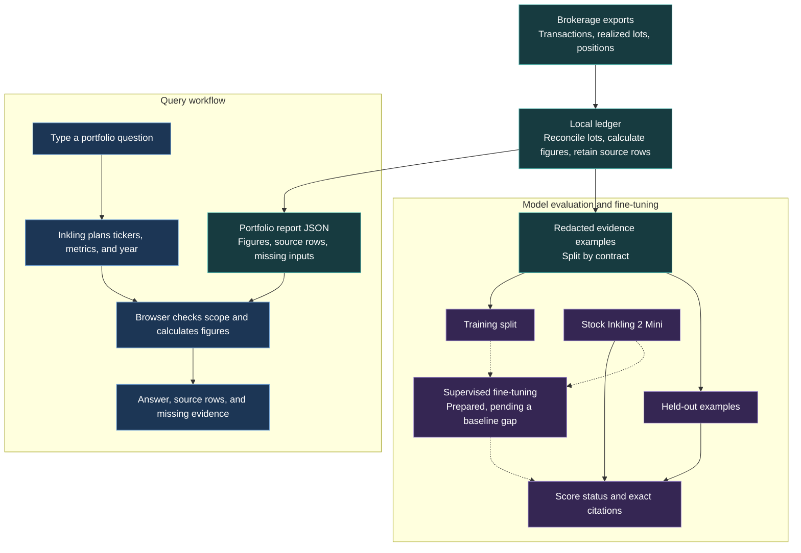

# What it takes to post-train Inkling for a real options book

I wanted to learn how post-training works by building something I would actually use. My brokerage history gave me a problem I knew well. After a busy stretch of options trading, a single position can involve multiple fills, partial exits, and a roll into another expiration. Weeks later, I might want to know which opening lots a close used, how much gain I realized, or why the broker’s cost basis differs from what I reconstructed.

I started with a simple question. Could I build a system that answers those questions in plain English and shows me the records behind each answer?

The bigger idea is a research and operations tool for an active options book. I want to bring together realized and unrealized P&L, concentration, expirations, assignment exposure, margin, and broker-reported tax adjustments. Each of those numbers needs a date, a definition, and a trail back to the source. Getting that right turned out to be the most interesting part of the project.

## How the pieces fit together

The report stays in the browser. Inkling receives the question and returns a plan for the browser to execute. The dashed path shows where fine-tuning would fit if testing reveals a gap worth addressing.

## I built the ledger first

I started with my own transaction history, realized gain and loss exports, and dated positions snapshots. Each file tells a different part of the story. Transactions record the activity and cash flows. Realized gain and loss detail shows the lots and basis the broker attributed to a disposal. A positions snapshot shows what was open and what it was marked at on a specific date.

I wrote a Python ledger that reads those exports locally, preserves source row numbers, and uses decimal arithmetic for money. It reconstructs provisional option lots and checks the result against the broker’s reported dates, quantities, proceeds, and basis. When only part of an opening fill is closed, the ledger allocates cost to the partial quantity while keeping the original fill’s total cash intact.

The edge cases showed me why trade data needs its own logic. A close can be posted in January with a December effective date. The reconciliation uses the effective trade date to match transactions. The annual broker report still follows the broker’s reported close date. If an allocation is ambiguous, the ledger can surface that uncertainty and point to the rows involved. That distinction matters more to me than a polished explanation of the wrong lot.

## I turned ledger checks into post-training tasks

One training task asks the model whether the recorded opening fills support the broker’s allocation. The input includes the required opening dates and quantities plus candidate rows. The target is a short JSON response with an evidence status and the exact row IDs. I can score the response automatically. A convincing paragraph earns nothing if it cites the wrong fill.

I first ran supervised fine-tuning and reinforcement-learning pilots on a different open-weight model. The supervised run used a LoRA adapter and included a later experiment with redacted examples derived from my ledger. The reinforcement-learning run exposed a trade-off. Penalizing false claims of support made the model more cautious, but it also rejected more cases where the records did support the claim. That’s why I want to measure both errors separately before changing the reward or adding more training.

For Inkling 2 Mini, I prepared 423 redacted training examples and held out 168 by contract. I added 24 synthetic cases in which the close could not be verified. The examples preserve evidence patterns and replace source row IDs with aliases. The raw exports and tax documents stay local.

## What Inkling 2 Mini did on the GPU

I ran **stock Inkling 2 Mini** on a Runpod B200. It got **42 out of 44** on the portfolio-routing regression set in that run. On the separate evidence benchmark, it got **99 out of 192** when citations had to be JSON integers. Accepting quoted numeric row IDs raised the score to **183 out of 192**. It made zero false confirmations on the 24 synthetic unverified-close cases.

That gap changed what I’d try next. Most strict-score misses came from output formatting, which is something I can address with a structured response or a narrow parser change before renting GPUs to tune weights. The benchmark also gave Inkling evidence the ledger had already classified, so it measures how well the model interprets and cites that evidence. The next test needs messier inputs, including partial quantities across months and competing lot allocations.

At this point, the Inkling milestone is a working inference baseline and a dataset prepared for supervised fine-tuning. The adapter experiments came earlier on the other model. I haven’t trained an Inkling adapter yet. I’ll compare one against stock Inkling under the same decoding settings if the next holdout exposes a recurring error worth training on.

## What I want to build from here

I built a query workspace that loads a locally generated portfolio report. An early version asked Inkling to pick a single query category. That broke on a natural question about losses and dividends for two tickers, even though the report had the holdings and dividend records.

The planner now extracts the tickers, metrics, and year in one request and writes a short sentence with a results placeholder. The browser validates the plan, calculates the figures, and inserts the answer locally. When I import newer transactions, I regenerate the report to update the numbers without retraining the model.

I tested the hosted path on a Runpod L4 with stock Inkling 2 Mini served by llama.cpp. A synthetic report let me verify that the live Site returned the right figures for both tickers and both metrics. Earlier cold starts timed out or returned gateway errors, so I pinned the endpoint to the data center where the compound test passed. That test measures the application workflow. The evidence holdout above measures a different skill: how well the model interprets and cites supplied evidence.

I want to take this further for people who trade options frequently. A useful system could trace a multi-leg position from entry through partial exits, explain where realized P&L came from, and show which expirations or assignments might create liquidity pressure. For margin, I’d want timestamped broker figures and verified contract deliverables before making a claim about buying power. For taxes, I want to show broker-reported gains and adjustments alongside the supporting lots, including where the available records leave a gap. This prototype works from periodic exports. A live view would need current positions, market data, and broker margin inputs.

I started this to learn how to specialize a model. The project taught me to be precise about what I want it to learn. I want Inkling to recognize what I’m asking, find the right calculation, and cite the evidence that supports the answer. The more complex the options book, the more valuable it is to be able to check every step.

[Ledger workflow and benchmark details](README.md)
